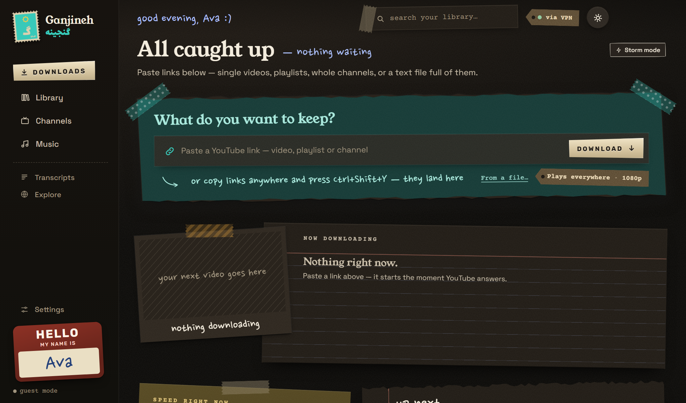
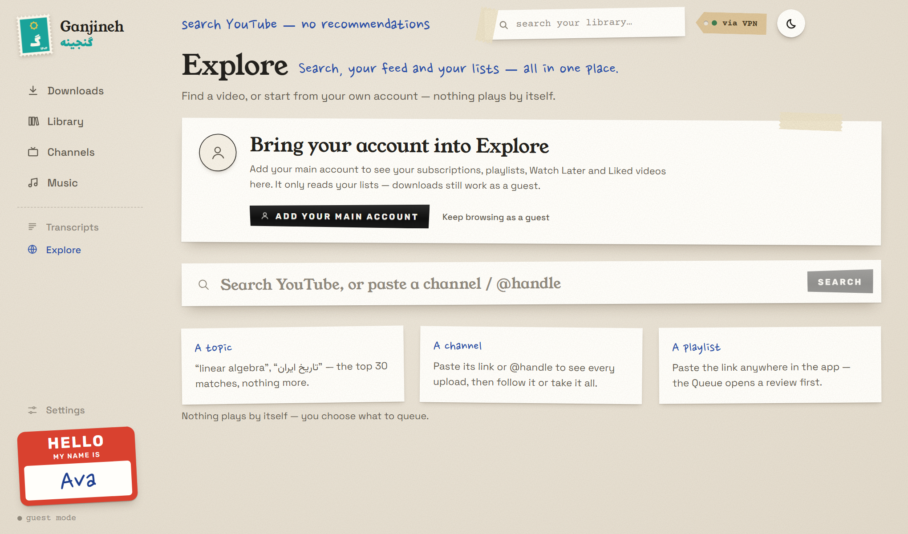
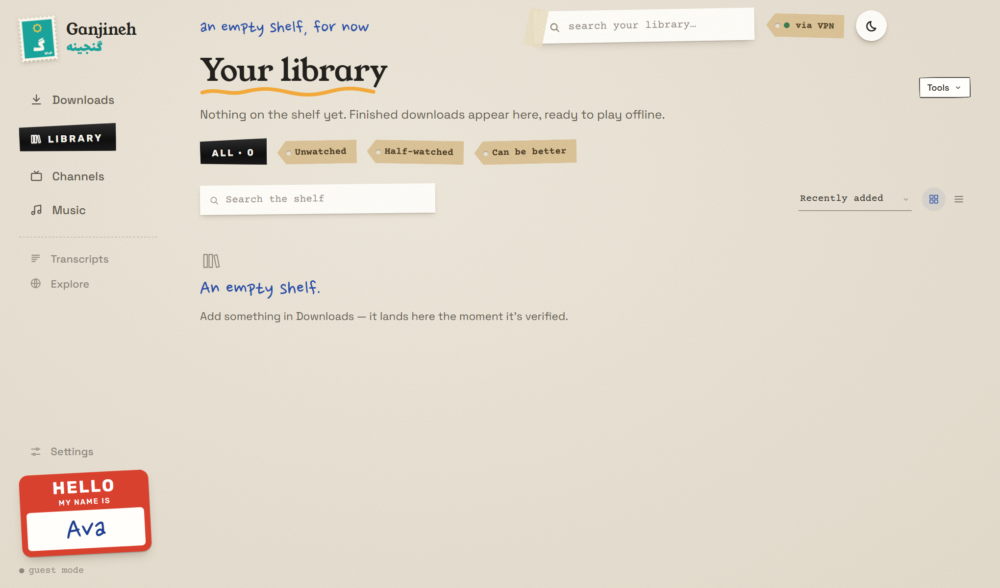
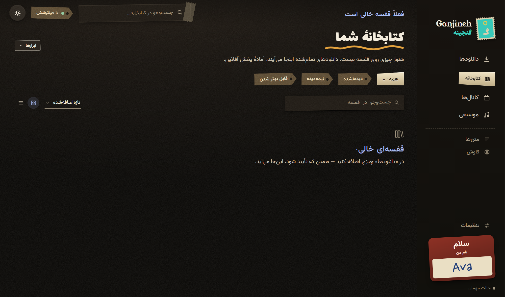

# Ganjineh · گنجینه

**A personal YouTube archive for Windows that behaves like a paper library.**

Ganjineh 1.1.0 · Windows 10/11 x64 · portable, no installer · English and Persian

---

## What it is

Ganjineh is a desktop app for keeping the YouTube videos you actually want to keep. You paste a link
— a video, a playlist, a whole channel, or a text file full of links — and it downloads them into an
ordinary folder on your disk, one file per video, named by channel and title, with subtitles and a
small record beside each one. Nothing is streamed, nothing is locked in a database, and nothing plays
by itself: files stay files, and you can copy them to a USB stick and they still play.

The rest of the app is built around that shelf. There is a library you can search by what was said in
the videos, a queue that survives a dropped VPN or a power cut, a Channels page for the creators you
follow, and — since 1.1 — an Explore page that is the home of your own YouTube account: your
subscriptions, playlists, Watch Later and Liked videos, right next to the shelf they feed.

It is portable and unsigned. You extract a zip, run `Ganjineh.exe` once past SmartScreen, and
everything Ganjineh knows lives in a folder beside it. Delete the folder and the app is gone.


*The Downloads desk in **Ink**, the dark look.*

## Features

### Library and playback

- **A shelf, not a service.** Every video is a plain file at
  `Videos\Ganjineh\<Channel>\<Title> [id].mp4`, with its subtitles and a small sidecar record next to
  it. Copy the folder anywhere; the videos still play.
- **Search what was said.** Ganjineh keeps searchable transcripts, so `Ctrl+K` finds a video by a
  sentence you remember, not just by its title.
- **Watched marks, filters and a shelf view** that tell you what you have seen and what is still
  waiting — plus a Music tab for the audio-only things you keep, and a Transcripts tab for the text.
- **Bulk everything.** Press `Select` (or Ctrl-click a video), then click, drag across or Shift-click
  a range: mark watched or unwatched, copy links, or delete the whole selection at once.

### Downloads and queue

- **Paste and go.** A video, a playlist, an entire channel, or a `.txt` of links — on the Downloads
  desk. A playlist or channel arrives as a numbered "volume", so you can tick exactly what you want.
- **Picks that scale.** Drag down a run of checkboxes, Shift-click a range, or use `pick №` and type
  `1-10, 15` — or `۱ تا ۱۰، ۱۵`, Persian digits included. `Ctrl+A`, `Ctrl+Shift+A`, `Ctrl+I`, `Esc`,
  `Delete`, arrow keys and `Space` all work, and the black bar then acts on the whole selection:
  Pause, Resume, Retry, Move to front, Copy links, Remove.
- **A queue that waits for you.** VPN drops, internet blackouts and power cuts are survivable: the
  queue pauses, then continues exactly where it stopped, and nothing is downloaded twice. Close the
  window mid-download and Ganjineh asks whether to keep going in the background.
- **The right shape for each thing.** Video presets by height, audio-only as M4A, Opus or MP3,
  subtitles when they exist, chapters, and optional sponsor marks the player skips over.
- **Politeness built in.** A speed limit so the rest of the house still has bandwidth, an option to
  keep the PC awake while downloading, and a choice of what happens when the queue finishes — nothing,
  sleep, or shut down with a warning.

### Explore and your account

- **Your account, at home.** An account card with your display name, `@handle` and avatar, and six
  tabs: Search · Feed · Playlists · Watch later · Liked · History.
- **Feed** with Subscriptions and Home, **Playlists** as a browsable grid that opens into a playlist,
  **Watch later** and **Liked** straight from your account, and **History** from YouTube.
- **Queue all**, or queue one row at a time; rows tell you at a glance whether something is already
  **on the shelf** or **in the queue**.
- **Signing in is optional.** Without a main account, Explore shows a guest card and keeps Search
  working. With one, it only ever *reads your lists* — a separate spare account can do the heavy
  downloading if you would rather not risk the main one.
- **No autoplay, ever.** Nothing starts playing because a page loaded. Every video is explicitly
  queued or opened by you.
- **Honest limits.** When a list is longer than what Ganjineh loads, it says so — "showing the first
  60 of N videos" — instead of pretending that is all there is.

### Look and language

- **Two looks, both drawn by hand.** *Paper* is the daylight look; *Ink* is the same desk at night,
  lit by one warm lamp — near-black desk, warm paper sheets, label tape you could almost peel off.
  Switch in Settings › General › Appearance, or with the moon/sun button at the top.
- **A postage-stamp icon.** Perforated paper, a teal field and a gold eight-point Persian star with
  the letter **گ** — on the window, the taskbar, the tray and the executable itself.
- **Genuinely bilingual.** English and Persian throughout, right-to-left, with Persian digits and an
  optional Solar Hijri (Jalali) calendar. Not a translation layer on top: the layout is written for
  both.
- **Loading, empty and error states** that tell you what is happening — skeletons instead of blank
  screens, a real empty state per list, a retry button when YouTube cannot be reached, and a quiet
  note when you are looking at cached data.

### Privacy

- **Everything stays on the PC.** Settings, the queue, the library index, your accounts and the logs
  are files in `GanjinehData\` beside `Ganjineh.exe`. There is no Ganjineh server, no telemetry, no
  analytics, no ads and no account of its own.
- **Cookies never leave the machine.** Account cookies are encrypted with Windows DPAPI and sent only
  to YouTube, only when a request needs them.
- **Nothing to uninstall.** Delete the app folder and your data goes with it; `Remove from this PC…`
  takes the Start menu entry and the `ganjineh://` link as well. Your videos are untouched. The full
  story, including every network destination, is in [PRIVACY.md](PRIVACY.md).

## Screenshots

All of these come from a clean guest instance: an empty shelf, no account added, nothing downloaded
yet.


*Explore without an account — search still works, and the card invites you in.*


*The Library, empty, in **Paper** — the light look.*


*The same empty shelf in Persian, in **Ink**: right-to-left, Jalali dates, Persian digits.*

## Download

Get the latest build from the **[Releases page](../../releases/latest)**. Two files sit there:

| Asset | What it is |
|---|---|
| `Ganjineh-1.1.0-win-x64.zip` | about **273 MB**; it extracts to about **613 MB** in a folder named `Ganjineh-1.1.0-win-x64` |
| `SHA256SUMS.txt` | one line: the SHA-256 of the zip, published next to it on the same release |

The app is not committed to this repository — its executable alone is about 238 MB, well over GitHub's
100 MB per-file limit — so it ships as a release asset.

Verify the download before you run it:

```powershell
Get-FileHash .\Ganjineh-1.1.0-win-x64.zip -Algorithm SHA256
```

The `Hash` value this prints must be the same hash as the single line in `SHA256SUMS.txt` on the
release page. If it is not, delete the file and download it again — do not run it.

**First launch and SmartScreen.** Ganjineh is not code-signed, so Windows shows *"Windows protected
your PC"* the first time. Click **More info → Run anyway**. That happens once per PC; the app is
unsigned because there is no signing certificate behind this project, and the hash is the honest way
to check what you downloaded.

**Requirements**

- Windows 10 or Windows 11, 64-bit.
- About 600 MB of disk space for the app itself, plus room for the videos you archive.
- No installer, no admin rights, no other software to install: the download engine, a JavaScript
  runtime and ffmpeg all travel inside the zip.

## First run

1. **Extract the zip** with Windows' own *Extract All…* (right-click the zip → Extract All). Do not run
   `Ganjineh.exe` from inside the zip: Windows would run a temporary copy, and portable mode would keep
   your data in that temporary folder instead of one you can find again.
2. **Double-click `Ganjineh.exe`.** Past the SmartScreen prompt, the app opens on a three-step setup:
   language and look, where the shelf lives, and accounts (optional — you can skip it and stay a
   guest).
3. **That is it.** `GanjinehData\` appears next to the exe and holds your settings, your queue and your
   library index from then on. Move the whole folder to another PC or a USB drive and it comes with
   you, which is what `portable.txt` is for.

If you would rather keep that data in your Windows user profile instead, delete `portable.txt` before
the first run.

## Everyday use

- **Paste links on the Downloads desk** — a video, a playlist, a whole channel, or a text file of
  links.
- **Copy links anywhere, then press `Ctrl+Shift+Y`.** Ganjineh picks them up from any app, shows you
  what it found, and adds nothing without your say-so.
- **Install the browser button once.** Settings › Browser button: drag it to your bookmarks bar, and
  any YouTube page you are on can be sent to Ganjineh's review sheet with one click. `ganjineh://`
  links work from anywhere in Windows too.
- **`Ctrl+K` jumps anywhere and searches every spoken word** in your library.
- **Lose the VPN, not the queue.** When YouTube disappears, downloads pause and the header says so;
  when it comes back, they continue. Power cuts are handled the same way: on the next start,
  half-finished downloads are checked and resumed.
- **The `via VPN` chip in the header is a status light, not a switch.** It appears when Ganjineh
  notices its traffic going through a proxy, which is why the dark screenshots above show it. The
  proxy itself is configured in Settings › Network: follow Windows, a local v2rayN/Clash port, or none.
- **If something goes wrong twice**, Ganjineh opens in safe mode with downloads paused and the library
  intact. Settings › About & logs has the logs and the way out.

## Where files live

| What | Where |
|---|---|
| The app | The folder you extracted. No installer ran, no admin rights were needed; Ganjineh only adds one Start menu shortcut and the `ganjineh://` link, both under your user account. |
| Settings, queue, library index, accounts, logs | `GanjinehData\` beside `Ganjineh.exe` (portable mode, because of `portable.txt`) |
| Your videos | Your library folder, by default `Videos\Ganjineh\<Channel>\<Title> [id].mp4`, with subtitles and a small sidecar record beside each file |
| Logs | `GanjinehData\data\logs\` — also reachable from Settings › About & logs |

The library folder can live anywhere (an external drive, a NAS): Settings › Library & storage sets it,
and the files stay plain files wherever they are.

## FAQ

**Do I need a YouTube account?**
No. Everything works as a guest; some videos — age-restricted ones, long playlists — go more smoothly
with an account. If you add one, the *main* account is only used to read your lists. Ganjineh also
supports a separate *spare* account for bulk downloading, so a ban would cost you the spare and not
your main account.

**Will it steal my YouTube account?**
There is nowhere for it to go. Cookies are encrypted with Windows DPAPI in `GanjinehData\`, decrypted
only for the bundled download engine, and sent only to YouTube over HTTPS — not to the author, not to
GitHub, not anywhere. Ganjineh has no server of its own. If you want more distance, use a spare
account, which is exactly what that feature is for.

**Does it work behind a VPN or a proxy?**
Yes, and there is a setting for it. Settings › Network offers *Use Windows settings* (which follows
your VPN app automatically), *Custom* for v2rayN, Clash or similar on a local port, and *No proxy*. A
dropped connection does not lose work: the queue waits and resumes.

**Does it phone home?**
No. No telemetry, no analytics, no crash-reporting service, no usage counters. Ganjineh talks to
YouTube because that is where the videos are, and to GitHub to check the download engine for updates
at most once every 72 hours (switchable). Every destination is listed in [PRIVACY.md](PRIVACY.md).

**Can I move my library, or take it to another PC?**
Yes. The videos are plain files, so copy the library folder wherever you like and point Settings ›
Library & storage at it. To take the whole experience along, copy the app folder *and* `GanjinehData\`;
the library can be on the same drive or on an external one.

**How do I update?**
Close Ganjineh and replace the app files: extract the new release zip, copy its contents over the
folder that holds `Ganjineh.exe`, and choose **Replace** when Windows asks. Keep `GanjinehData\` — that
is where your queue, settings and accounts live, and it is not part of the download. There is no
separate updater and no separate update zip: the release you see is the whole app. The download engine
can also be updated on its own from Settings › Download engine.

**How do I remove it?**
Settings › About & logs › **Remove from this PC…** removes the Start menu entry and the `ganjineh://`
link, then quits. Delete the app folder yourself — that takes `GanjinehData\` with it, so nothing is
left behind. Your videos are never touched; delete the library folder as well if you want those gone
too.

**Why is it unsigned?**
Code-signing certificates cost money every year, and this is a small personal project. The trade-off
is that Windows warns once, and the honest check is the SHA-256 hash in `SHA256SUMS.txt`. There is no
auto-updater and no background service: when a new version appears, you download it yourself.

## فارسی

**گنجینه** یک آرشیو شخصی یوتیوب برای ویندوز است: یک قفسهٔ کاغذی برای ویدیوهایی که نمی‌خواهید از دست
بروند. لینک را روی میز «دانلودها» می‌چسبانید — یک ویدیو، یک فهرست پخش، یک کانال کامل یا فایلی پر از
لینک — و گنجینه آن‌ها را در پوشه‌ای معمولی روی رایانهٔ خودتان ذخیره می‌کند: یک فایل برای هر ویدیو، با
نام کانال و عنوان، همراه زیرنویس و یک برگهٔ کوچک در کنارش.

- **نسخهٔ ۱.۱.۰، ویندوز ۱۰ و ۱۱ (۶۴ بیتی)، قابل حمل.** از بخش Releases فایل
  `Ganjineh-1.1.0-win-x64.zip` را دانلود کنید. پیش از اجرا، هش SHA-256 را با `SHA256SUMS.txt`
  مقایسه کنید.
- **اجرای اول:** زیپ را با Extract All باز کنید، بعد `Ganjineh.exe` را اجرا کنید. چون برنامه امضای
  دیجیتال ندارد، ویندوز یک بار پیام «Windows protected your PC» می‌دهد: **More info** و بعد
  **Run anyway**.
- **همه‌چیز روی رایانهٔ خودتان می‌ماند.** تنظیمات، صف، فهرست کتابخانه، حساب‌ها و گزارش‌ها در پوشهٔ
  `GanjinehData` کنار فایل اجرایی‌اند (چون `portable.txt` آنجاست). هیچ سروری برای حساب یا آمار وجود
  ندارد؛ هیچ داده‌ای برای سازندهٔ برنامه فرستاده نمی‌شود.
- **حساب یوتیوب اختیاری است.** بدون حساب هم دانلود کار می‌کند. حساب اصلی فقط فهرست‌های شما را
  می‌خواند («تماشا در فرصتی دیگر»، «ویدیوهای پسندیده»، فهرست‌های پخش)؛ برای دانلود سنگین می‌توانید یک
  حساب کمکی جدا اضافه کنید.
- **کاوش، خانهٔ حساب شماست:** اشتراک‌ها، فهرست‌های پخش، «تماشا در فرصتی دیگر»، «ویدیوهای پسندیده» و
  «تاریخچه»، همراه با جست‌وجو. هیچ‌چیز خودبه‌خود پخش نمی‌شود.
- **انتخاب گروهی در همه‌جا:** کشیدن روی تیک‌ها، Shift و کلیک، «انتخاب با شماره» با ارقام فارسی
  (۱ تا ۱۰، ۱۵)، و کلیدهای Ctrl+A و Ctrl+I؛ نوار سیاه روی همهٔ انتخاب‌ها کار می‌کند.
- **دو ظاهر:** «کاغذ» روشن و «جوهر» تیره. رابط کامل فارسی و راست‌به‌چپ، با ارقام فارسی و گزینهٔ
  تاریخ شمسی.
- **ویدیوها فایل ساده‌اند:** `Videos\Ganjineh\<کانال>\<عنوان> [id].mp4`، با زیرنویس و یک برگهٔ
  کوچک در کنار هر فایل. هر جای دیگری کپی کنید، باز هم پخش می‌شوند.
- **حذف:** تنظیمات › درباره و گزارش‌ها › «حذف از این رایانه…»، بعد پوشهٔ برنامه را پاک کنید. به
  ویدیوهای شما دست زده نمی‌شود.
- **مجوز:** MIT. فهرست اجزای ثالث و مجوزهایشان در [THIRD-PARTY-NOTICES.md](THIRD-PARTY-NOTICES.md)
  آمده است.

**نکتهٔ امنیتی:** گنجینه امضای دیجیتال ندارد، پس تنها راه اطمینان از سالم بودن فایل، مقایسهٔ هش
SHA-256 با `SHA256SUMS.txt` است. سیاست کامل داده‌ها در [PRIVACY.md](PRIVACY.md) آمده است.

## Licenses & credits

The app is distributed as a packaged build under the **MIT license**. The version you download declares
`"license": "MIT"` in its `package.json`, this repository carries the MIT text in [LICENSE](LICENSE),
and every release zip ships the same text as `LICENSE.txt` next to `Ganjineh.exe`. Copyright (c) 2026
Ganjineh.

It is not open source in the "clone it and build it" sense: this repository publishes the
documentation, the screenshots and the release assets, not the application source.

Ganjineh stands on other people's work. Every component inside the zip is credited with its version,
license and upstream link in **[THIRD-PARTY-NOTICES.md](THIRD-PARTY-NOTICES.md)** — yt-dlp, Deno, an
ffmpeg shared build, Electron and Chromium, and the typefaces used in the interface. The same file
travels inside the zip as `THIRD-PARTY-NOTICES.txt`, so the credits reach you even if you never open
this repository.

FFmpeg is included as a **GPLv3** shared build (build `N-127911-gadfe258a6a`, 2026-10-21). Its complete
corresponding source is available from <https://git.ffmpeg.org/ffmpeg.git> at commit `adfe258a6a`, and
the written offer to supply that source on request — with the exact build id and configure line — is
recorded in [THIRD-PARTY-NOTICES.md](THIRD-PARTY-NOTICES.md).

Ganjineh is a tool for keeping videos you have the right to keep. Respect YouTube's terms and the
rights of the people who made what you archive.

---

Made for one person's archive — a shelf that stays where you put it, and files that outlive the app
that fetched them.
